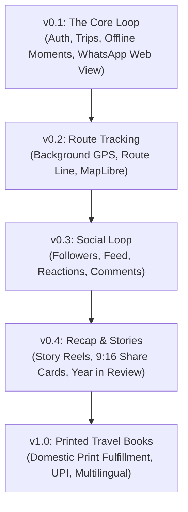

# Travel App (Trip Moments) — Architecture & Build Plan

> **Build Plan for an India-First, Globally Usable Trip-Sharing App**  
> *Last Updated: October 18, 2026*  
> *Target Stack: Expo SDK 57 · React Native 0.86 · Go REST API · Cloudflare R2 / S3*

---

## 🧭 Executive Summary

This architecture establishes an **India-first, globally usable trip-sharing platform** inspired by the core product mechanics of Polarsteps.

We adapt the proven feature loop into an original, high-performance product tailored for Indian and global travelers:
- **Original Identity**: Proprietary branding, distinct typography (`Fraunces` editorial serif, `IBM Plex Mono` stamps, `Inter` UI body), and tactile `LiquidGlass` translucent surfaces.
- **India-First Wedge**: WhatsApp-first sharing loop with rich Open Graph previews, domestic UPI checkout, rupee-priced printed travel books, offline resilience across remote mountain passes, and native Hindi/English language support.
- **Local-First with Cloud Sync**: Full offline capability while traveling off-grid (Himalayan treks, Ladakh circuits, Western Ghats), followed by idempotent background sync when connectivity resumes.

---

## 🗺️ What We Are Building: The Four Jobs

| Job | Description | Implementation |
|---|---|---|
| **1. Planning** | Itinerary structuring, saved destinations, and travel dates | Trip cover, day breakdowns, planned routes, and place bookmarks |
| **2. Tracking** | Automatic low-power GPS breadcrumbs and route plotting | Topological route maps, location clustering, elevation stats, and offline cache |
| **3. Sharing** | Letting friends and family experience the journey | 3 privacy tiers (Private, Link-only, Followers), WhatsApp-first web viewer with rich previews |
| **4. Printed Books** | Tangible memory keepsake ordered post-trip | Rupee-priced photobook generator with Indian print-on-demand fulfillment |

---

## 🚀 Phased Build Order



### Phase v0.1 — The Core Loop (In Progress / Current Baseline)
- **Sign-in**: Google OAuth and Email/Password credentials.
- **Trip Management**: Create, view, edit, and archive trips with destination, cover photo, notes, and custom color palettes.
- **Moments & Daily Diary**:
  - Offline photo and note captures with reverse geocoding and local weather stamps.
  - **Daily Diary**: Daily summary card atop each journal day with pre-filled facts skeleton (no AI), starter prompts (food, people, surprises), mood chips, and linked photo thumbnails.
  - Private-by-default security flags.
- **Public Trip Web Viewer**: Server-rendered / static web page per trip with WhatsApp/Open Graph rich previews (`og:image`, `og:title`, `og:description`).
- **Privacy Tiers**:
  1. `Private`: Visible only to the author (default for diary entries).
  2. `Link-Only`: Accessible to anyone with the secret link (WhatsApp sharing).
  3. `Followers`: Visible to approved followers.
- **Languages**: English and Hindi localization foundation.

### Phase v0.2 — Automatic Route Tracking
- **Background Location Service**: Low-power battery-efficient breadcrumb logging using `expo-location` and geofencing.
- **Route Smoothing**: Kalman filtering / Douglas-Peucker line simplification to reduce GPS noise and payload size.
- **MapLibre Integration**: Vector tile rendering with offline vector caching for trail navigation.

### Phase v0.3 — Social & Community Loop
- **Follow System**: Follow requests, approved followers, and link-based invites.
- **Traveler Feed**: Chronological stream of updates from followed explorers.
- **Reactions & Comments**: Lightweight travel stamps, hearts, and comments with push notifications.

### Phase v0.4 — Story Reels & Recaps
- **Auto-Built Story Reels**: Instagram Stories-style auto-advancing reels with photo progress bars.
- **Exportable 9:16 Cards**: High-res share cards rendered with travel statistics for Instagram/WhatsApp Stories.
- **Year in Review**: Aggregated passport statistics (countries, cities, distance, moments count).

### Phase v1.0 — Printed Travel Books & Commercial Scale
- **Photobook Builder**: Automated book layout engine compiling diary entries, high-res photos, and route maps into a print-ready PDF.
- **Domestic Print Fulfillment**: Direct API integration with quality Indian photo album printers.
- **UPI & Payment Gateway**: Frictionless checkout via Razorpay / Cashfree (UPI, Cards, NetBanking).
- **Expanded Languages**: Regional Indian languages (Tamil, Telugu, Marathi, Bengali).

---

## 🏛️ System Architecture

```
┌─────────────────────────────────────────────────────────────┐
│                       MOBILE CLIENT                         │
│   Expo SDK 57 · React Native 0.86 · React 19 · LiquidGlass  │
│                                                             │
│   ┌───────────────────┐               ┌─────────────────┐   │
│   │  Screen Layer     │               │  Sync Outbox    │   │
│   │  (10 Screens)     │               │  (AsyncStorage) │   │
│   └─────────┬─────────┘               └────────┬────────┘   │
└─────────────┼──────────────────────────────────┼────────────┘
              │                                  │
              │ HTTPS JSON                       │ Idempotent Sync
              ▼                                  ▼
┌─────────────────────────────────────────────────────────────┐
│                      BACKEND SERVICES                       │
│                   Go (Golang) REST API                      │
│                                                             │
│   ┌─────────────────────────────────────────────────────┐   │
│   │  Auth Middleware (JWT / Google OAuth)               │   │
│   ├─────────────────────────────────────────────────────┤   │
│   │  /api/v1/trips             Trip CRUD & Privacy      │   │
│   │  /api/v1/moments           Moment CRUD & Weather    │   │
│   │  /api/v1/diary             Daily Diary CRUD         │   │
│   │  /api/v1/sync/batch        Idempotent Outbox Sync   │   │
│   │  /api/v1/media/upload-url  Presigned S3/R2 URLs     │   │
│   │  /api/v1/share/:slug       Public Web View + OG     │   │
│   └─────────────────────────────────────────────────────┘   │
└─────────────┬──────────────────────────────────┬────────────┘
              │                                  │
              ▼                                  ▼
┌───────────────────────────────┐  ┌──────────────────────────┐
│          DATA STORE           │  │      MEDIA STORAGE       │
│  PostgreSQL (Relational data, │  │  Cloudflare R2 / AWS S3  │
│  spatial PostGIS for routes)  │  │  Client-side compressed  │
│                               │  │  WebP / CDN distribution │
└───────────────────────────────┘  └──────────────────────────┘
```

---

## 📦 Data Models

### 1. Trip (`trips`)
```json
{
  "id": "trip_01j7x4...",
  "userId": "usr_98a7c...",
  "title": "Golden Sunrise in Hampi",
  "city": "Hampi",
  "country": "India",
  "startDate": "2026-10-14",
  "endDate": "2026-10-18",
  "status": "active",
  "privacy": "link_only",
  "shareSlug": "hampi-sunrise-829d",
  "coverUri": "https://cdn.tripmoments.app/trips/cover-1.jpg",
  "themeColor": "#16845B",
  "secondaryColor": "#D97706",
  "notes": "Exploring the 14th-century Vijayanagara ruins and granite boulder hills.",
  "tripType": "heritage_roadtrip",
  "totalDistanceKm": 360.5,
  "createdAt": "2026-10-14T05:00:00Z",
  "updatedAt": "2026-10-18T12:00:00Z"
}
```

### 2. Moment (`moments`)
```json
{
  "id": "m_01j7x5...",
  "tripId": "trip_01j7x4...",
  "userId": "usr_98a7c...",
  "takenAt": "2026-10-15T06:15:00Z",
  "title": "Dawn over Virupaksha Gopuram",
  "text": "First golden light illuminating the 50-meter gopuram.",
  "placeName": "Virupaksha Temple, Hampi Bazaar",
  "city": "Hampi",
  "country": "India",
  "latitude": 15.3350,
  "longitude": 76.4600,
  "weather": {
    "temp": 24,
    "condition": "Sunny",
    "icon": "sunny"
  },
  "mediaUri": "https://cdn.tripmoments.app/moments/photo-1.jpg",
  "mediaType": "photo",
  "tags": ["temple", "sunrise", "heritage"],
  "isFavorite": true,
  "createdAt": "2026-10-15T06:20:00Z",
  "updatedAt": "2026-10-15T06:20:00Z"
}
```

### 3. Diary Entry (`diary_entries`)
```json
{
  "id": "diary_01j7x6...",
  "tripId": "trip_01j7x4...",
  "userId": "usr_98a7c...",
  "dateKey": "2026-10-15",
  "text": "Woke up at 5:30 AM before the sun cleared the boulder ridge...",
  "mood": "blown_away",
  "linkedMomentIds": ["m_01j7x5..."],
  "isPrivate": true,
  "factsSkeleton": "📍 Hampi Bazaar · 🌤️ 27°C Golden Hour · 📸 3 moments · 🚶 ~2.8 km",
  "tags": ["sunrise", "peace"],
  "audioUri": null,
  "createdAt": "2026-10-15T19:30:00Z",
  "updatedAt": "2026-10-15T19:30:00Z",
  "deletedAt": null
}
```

---

## 🔄 Offline Outbox & Sync Protocol

To survive no-signal zones across Indian national parks, deserts, and high-altitude trails, write operations are queued into an **offline outbox**:

```
[User Action: Capture Moment / Diary]
        │
        ▼
[Write to Local AsyncStorage (Immediate UI Update)]
        │
        ▼
[Enqueue to @sync_outbox (UUID, Entity, Payload, Timestamp)]
        │
   Network Available?
      ├── YES ──► [Batch POST /api/v1/sync/batch]
      │                 │
      │                 ├── 200 OK ──► [Mark synced, remove from outbox]
      │                 └── Error  ──► [Retry with exponential backoff]
      │
      └── NO  ──► [Retain in outbox until reconnect]
```

### Media Upload Strategy
1. **Client-side Compression**: Photos are downscaled on-device to max 1600px width/height and converted to high-efficiency WebP/JPEG (`quality: 0.82`) before upload.
2. **Presigned Uploads**:
   - `GET /api/v1/media/upload-url?filename=xyz.jpg&contentType=image/jpeg`
   - Returns temporary signed S3/R2 URL.
   - Client uploads directly to bucket without proxying heavy binary data through the app API server.
3. **Quota Protection**: Free accounts have a 1,000 photo cap before requiring cloud expansion, preventing unbounded cloud costs.

---

## 💬 WhatsApp Growth Loop & Web Viewer

In India, WhatsApp is the default social communication channel. When a traveler taps **"Share Trip Link"**, the generated link resolves to a server-rendered public viewer:
- **Rich Open Graph Metadata**:
  - `og:title`: `Golden Sunrise in Hampi · 5 Days · 12 Moments`
  - `og:description`: `Follow my journey through the ancient Vijayanagara ruins with Trip Moments.`
  - `og:image`: Dynamic cover card with trip stats badge and route snippet.
- **Interactive Web Page**:
  - Scrollable timeline showing moments, daily diaries (respecting privacy flags), and topological route maps.
  - "Follow on App" / "Install Trip Moments" sticky action.

---

## 🎨 Design Tokens & UI Aesthetics

- **Primary Color**: `#16845B` (Forest Green)
- **Secondary Accent**: `#D97706` (Warm Golden Amber)
- **Paper Background**: `#F7F8F7` (Light warm paper)
- **Night Surface**: `#0E1511` (Deep evergreen slate)
- **Ink Primary**: `#18201C`
- **Ink Soft**: `#66706A`
- **Typography**:
  - `Fraunces` (Editorial Serif, 400/500/600/700) for story titles, covers, and dates.
  - `IBM Plex Mono` (400/500/600) for timestamps, coordinates, and official ticket stamps.
  - `Inter` (400/500/600/700) for fluid body, labels, and UI captions.
- **Surface Material**: `LiquidGlass` translucent chrome with backdrop blur and subtle border highlights.

---

## 🧪 Current Testing & Verification

- **Test Suite**: 9 Jest test suites containing 49 comprehensive unit and smoke tests.
- **Execution**:
  ```bash
  cd frontend
  npm test
  ```
- **Coverage**:
  - Storage CRUD & distance math (`tripStorage.test.js`)
  - Diary entries persistence, mood, and privacy flags
  - Screen smoke tests (`screens.smoke.test.js`, `tripMomentsScreens.test.js`)
  - Component exports (`components.smoke.test.js`)
  - Web and app bootstrap rendering (`web.render.test.js`, `app.bootstrap.test.js`)
  - Theme tokens & font mappings (`theme.test.js`)